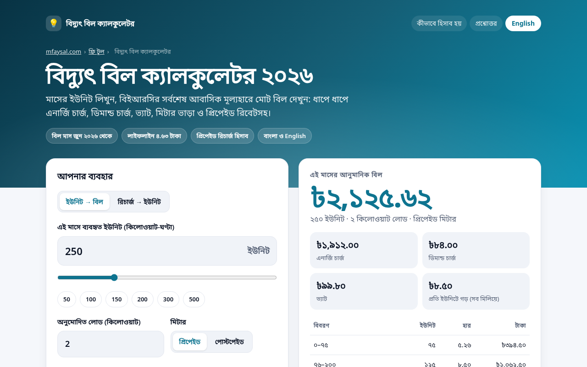

# Bangladesh Electricity Bill Calculator 2026 (বিদ্যুৎ বিল ক্যালকুলেটর)

**Live:** https://bangladesh-electricity-bill-calculator.vercel.app
**Project page:** https://mfaysal.com/projects/bangladesh-electricity-bill-calculator

A free, bilingual (**বাংলা** by default, English toggle) residential electricity bill calculator using the **BERC LT-A tariff in force from bill month June 2026**: Order No. 2026/22 (notice dated 3 June 2026) and Reconsideration Order No. 2026/01 (4 June 2026).



## Features
- Lifeline Tk 4.63 (only if the month is 50 units or less), then Tk 5.26 / 8.50 / 9.10 / 9.62 / 15.01 / 17.35 step rates
- Demand charge Tk 42 per kW a month
- Prepaid 0.5% rebate on the net bill before VAT
- Meter rent (Tk 40 single phase / Tk 250 three phase / own meter / custom) and VAT 5%, both editable, with optional VAT on meter rent
- Reverse mode: how many units a prepaid recharge buys
- Step-by-step bill table and bills at common usage levels
- Accessible (labels, keyboard, live regions), dark mode, no tracking, no cookies, no API keys
- SEO: canonical, Open Graph/Twitter card, `WebApplication` + `FAQPage` + `BreadcrumbList` JSON-LD, sitemap, robots.txt
- Bangla (`lang="bn-BD"`) by default with an English toggle; Bangla digits and lakh grouping (৳১২,০০,০০০)

## Tech
Plain HTML, CSS and JavaScript (ES modules), no build step and no dependencies. The calculation lives in [`public/bill.js`](public/bill.js) and is unit-tested (10 tests):

```bash
npm test   # node --test
```

| Test case | |
|---|---|
| BERC 2026 LT-A rates (Order 2026/22 + Reconsideration 2026/01) | ✅ |
| Lifeline: 50 units at Tk 4.63 = Tk 231.50 | ✅ |
| 51 units leaves the lifeline: all 51 at Tk 5.26 | ✅ |
| 100 units: 75 × 5.26 + 25 × 8.50 = Tk 607 | ✅ |
| 250 units: 394.50 + 1,062.50 + 455 = Tk 1,912 | ✅ |
| 700 units uses every step | ✅ |
| Postpaid bill for 250 units, 2 kW, Tk 40 meter rent, 5% VAT on energy + demand | ✅ |
| Prepaid gets 0.5% off the net bill before VAT | ✅ |
| Optional VAT on meter rent and custom VAT rate | ✅ |
| Recharge estimate: Tk 1,000 buys about how many units? | ✅ |

## Sources (checked 8 October 2026)
- [BERC notices: Order No. 2026/22 and Reconsideration Order No. 2026/01](https://berc.org.bd/pages/notices)

> **Disclaimer:** an estimate. Meter rent and VAT aren’t in the BERC order table, so check them against your bill. Late fees and arrears aren’t included.

## Author
Built by **[Mahir Faysal](https://mfaysal.com)**, a web developer in Bangladesh making free tools in Bangla and English.
- Website and blog: [mfaysal.com](https://mfaysal.com)
- Need a website or web app? [Hire a web developer in Bangladesh](https://mfaysal.com/hire-web-developer-bangladesh)
- All free tools: [mfaysal.com/uk-tools](https://mfaysal.com/uk-tools)
- Also try the [Bangladesh Income Tax Calculator](https://bangladesh-income-tax-calculator.vercel.app), [bKash, Nagad & Rocket Charge Calculator](https://bkash-nagad-rocket-charge-calculator.vercel.app), plus the UK [Take-Home Pay Calculator](https://take-home-pay-calculator-uk.vercel.app), [Hourly to Salary Calculator](https://uk-hourly-salary-calculator.vercel.app), [Energy Running Cost Calculator](https://uk-energy-cost-calculator.vercel.app), [Redundancy Pay Calculator](https://uk-redundancy-pay-calculator.vercel.app) and [Holiday Entitlement Calculator](https://uk-holiday-entitlement-calculator.vercel.app)

MIT licensed.
